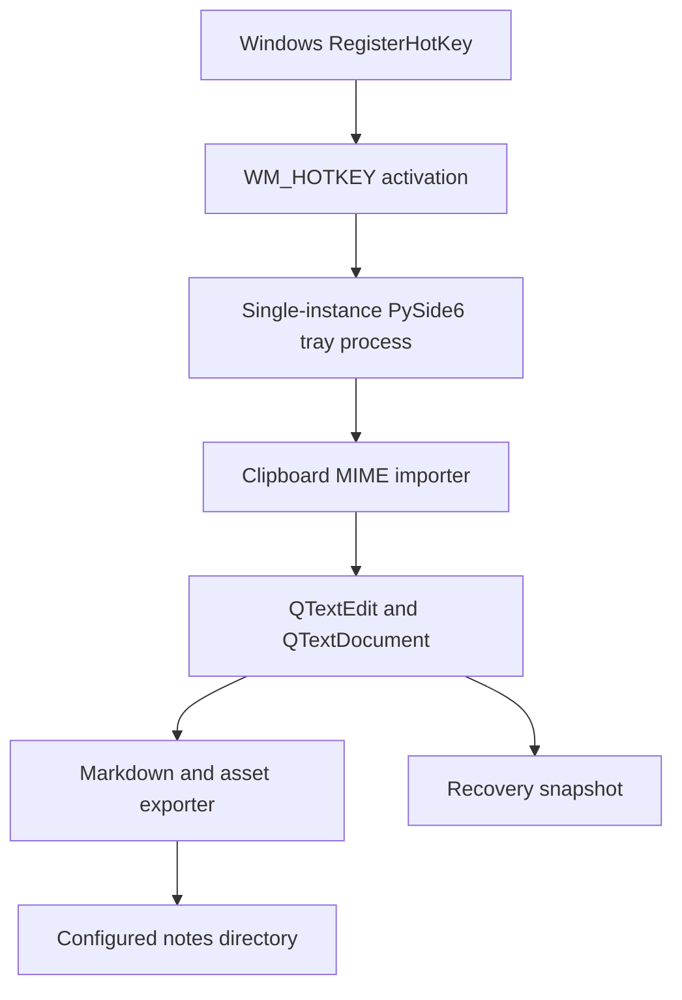

# NoteCatcher: Technical Project Specification

**Status:** Milestones 1–3 implemented; Brad validated QOwnNotes viewing of generated files  
**Version:** 0.1  
**Date:** 2026-11-08  
**Target platform:** Windows 11  
**Owner:** Brad Fike

## 1. Purpose

NoteCatcher is a lightweight, keyboard-driven desktop note capture utility. A global shortcut opens or focuses a small rich-text editor and imports the current clipboard contents, including text and images. The user can edit the captured content, then press a second shortcut to save a Markdown note with separately stored, relatively linked image assets. The editor then hides and returns focus to the application previously in use.

The app is optimized for quick capture from browsers, development tools, screenshots, and other Windows applications. It is **not** intended to replace QOwnNotes, Obsidian, or a full note manager.

### Goals

1. Minimize friction between copying content and storing a usable note.
2. Support mixed text, rich text, hyperlinks, lists, and inline raster images.
3. Produce human-readable Markdown and relative image links, compatible with common Markdown editors.
4. Respond quickly by running as a background tray application.
5. Preserve unsaved work and avoid accidental overwrites or silent content loss.
6. Stay portable and straightforward to develop on Windows without WSL.

### Non-goals for MVP

- Cloud sync, AI processing, tagging, full-text search, note library, or database.
- Perfect reproduction of arbitrary web-page HTML, CSS, tables, or embedded media.
- OCR, screenshots captured directly by the app, PDF parsing, or clipboard history.
- Multi-platform support or real-time collaboration.
- Direct integration with QOwnNotes APIs; filesystem interoperability is sufficient.

## 2. Agreed product decisions

### Implementation checkpoint

Brad confirmed that QOwnNotes can view the generated notes. Milestone 3 adds
validated storage, save-shortcut, behavior, recovery and logging settings;
confirmed draft discard; preservation of damaged recovery files; and rotating
event-only logs. See `config.example.toml` and README for the implemented options.
The sample configuration below remains the original design proposal: login startup
and capture/append policy are not TOML settings yet. Images remain PNG and append
is the capture policy. Native Windows RegisterHotKey now owns global capture;
`hotkeys.capture` configures it in TOML, and AutoHotkey is no longer required.
The editor also supports `hotkeys.cancel` (Esc) to clear the draft and hide without saving.
Automated coverage includes failed saves, failed recovery replacement, malformed
config, large-content rejection, and recovery after abrupt process termination.

| Topic | Decision | Status |
|---|---|---|
| Language | Python | Agreed |
| Python dependency management | `uv` | Recommended |
| GUI framework | PySide6 (Qt for Python) | Agreed direction |
| Editor widget | `QTextEdit` | Recommended MVP implementation |
| Global capture shortcut | `Ctrl+Alt+N` | Proposed default, configurable later |
| Global hotkey driver | Native Windows RegisterHotKey | Implemented |
| Save shortcut while editor focused | `Ctrl+Enter` | Proposed default |
| Capture when editor already open | Append the new clipboard content to the existing draft | Agreed |
| Primary note format | Markdown (`.md`) | Agreed |
| Image storage | Separate files with relative links | Agreed |
| After saving | Hide the editor and return to the prior app | Agreed |
| Background runtime | Single-instance tray app | Recommended |
| Asset folder name | `assets` by default | Recommended, configurable |
| Filename | Timestamp-based unique filename | Recommended |

**Design distinction:** The editor is WYSIWYG rich text, while the saved representation is Markdown. Conversion can be lossy for formatting Markdown cannot express. This limitation must be visible in documentation and tested.

## 3. User workflows

### 3.1 First capture

1. User copies text, an image, or formatted HTML from any Windows application.
2. User presses `Ctrl+Alt+N`.
3. Windows delivers WM_HOTKEY to the resident Python app, which shows the NoteCatcher window without launching a new process.
4. Python reads the system clipboard using Qt MIME data. The clipboard is not modified.
5. Clipboard contents are inserted into the editor. The caret moves to a predictable end position and receives focus.
6. User edits the draft freely.
7. User presses `Ctrl+Enter` while NoteCatcher has focus.
8. The application converts text to Markdown, writes any embedded images, and commits a new `.md` file.
9. On successful persistence, the editor clears its in-memory saved draft, hides the window, and attempts to restore focus to the app that was active before capture.

### 3.2 Capture again with an active draft

1. User copies a second item and presses `Ctrl+Alt+N`.
2. Existing NoteCatcher window is shown/focused.
3. New content is **appended**, separated from prior content by a paragraph break. Existing content is never replaced.
4. Repeated hotkeys with unchanged clipboard may duplicate content. This is acceptable for MVP; optional duplicate detection is a future enhancement.

### 3.3 Empty or unsupported clipboard

- Display/focus the editor, even if no supported clipboard content exists.
- Do not erase the current draft.
- Offer a brief non-blocking status indication such as `Clipboard has no supported content`.
- Allow typing a note from scratch.

### 3.4 Cancel, close, and crash recovery

- Hiding or closing a window with unsaved changes must **not** silently discard the draft.
- MVP recommended behavior: closing hides the window but retains the draft in memory; explicit `Discard draft` requires confirmation.
- Persist a recovery snapshot on meaningful changes, with debounce and an atomic-write strategy. Restore it on restart and inform the user.
- Do not append clipboard contents to a recovered draft until capture is explicitly requested.

## 4. Functional requirements

### FR-01: Background lifetime

- Start minimized to Windows notification area.
- Provide tray commands: `Open`, `Save note` (when possible), `Settings` (later), `Exit`.
- Enforce one running instance. A second launch should focus or signal the first rather than create a second independent draft.
- Support optional launch at user login in a later phase.

### FR-02: Clipboard ingestion

- Inspect `QGuiApplication.clipboard().mimeData()` for supported representations.
- For plain text, preserve line breaks.
- For HTML, let Qt import its supported formatting; normalize unsafe or unsupported content.
- For raster images, insert inline image resources into the `QTextDocument` and register their internal names for export.
- When both HTML and plain text exist, prefer HTML if meaningful; do not insert both versions.
- When image and text representations coexist, avoid duplicating the same payload.
- Support manual `Ctrl+V` after the window is open using the same image-aware path.
- Avoid retaining references to transient clipboard-owned MIME objects after their content is consumed.
- Treat clipboard HTML as untrusted input. The app must not execute scripts or fetch remote assets without explicit user intent.

### FR-03: Editing

- Use `QTextEdit` for the MVP.
- Minimum formatting: bold, italic, headings, unordered and ordered lists, hyperlinks, undo/redo, text selection, and inline images.
- Standard keyboard editing shortcuts continue to work.
- A small optional toolbar may expose common formatting; prioritize keyboard capture over editor chrome.
- Support viewport scrolling and resizing while preserving the edited document.
- Support images copied as bitmap data, not only images that originate as URLs.

### FR-04: Saving

- Save in configured output directory as a UTF-8 `.md` file.
- Save raster images into an `assets/` subfolder with collision-free names.
- Produce Markdown references such as ``.
- Use forward slashes in Markdown links and URL-encode or otherwise safely escape special filename characters.
- Default note filename pattern: `YYYY-MM-DD_HHMMSS[_suffix].md`, where a suffix handles collisions.
- Do not overwrite existing notes.
- Perform image extraction and link rewriting before final commit.
- Save only when all required assets and note content can be written successfully.
- Show a clear error and retain the draft on failure.
- On success, hide the editor and return to the previously focused application where the OS permits.

### FR-05: Configuration

MVP configuration may be a TOML file rather than a full settings UI:

```toml
[storage]
notes_dir = "E:/Notes/NoteCatcher"
assets_dir = "assets"
filename_pattern = "%Y-%m-%d_%H%M%S"
image_format = "png"

[hotkeys]
capture = "Ctrl+Alt+N"
save = "Ctrl+Enter"

[behavior]
capture_existing_draft = "append"
after_save = "hide"
restore_focus = true
launch_at_login = false
```

The drive path above is illustrative, not a chosen production location. On first launch, ask the user for a folder or provide a safe default in the user documents directory. Use `platformdirs` or an equivalent OS-aware location for app configuration and recovery state, not the notes directory unless explicitly requested.

## 5. Markdown and image representation

### 5.1 Example output

Directory layout:

```text
NoteCatcher/
├── 2026-11-08_091532.md
├── 2026-11-08_112045.md
└── assets/
    ├── 2026-11-08_091532_001.png
    └── 2026-11-08_091532_002.png
```

Markdown content:

```markdown
# Idea for the image catalog

Here is a screenshot of a tagging interface.


## Follow-up

- Try automatic tags
- Add image drag and drop
```

### 5.2 Export pipeline

Qt's `QTextDocument.toMarkdown()` is a useful starting point but **must not be assumed to export embedded images to disk**. A dedicated export layer is required:

1. Walk the `QTextDocument` blocks/fragments and locate `QTextImageFormat` entries.
2. Resolve each image through the document's image resources.
3. Encode to PNG (initial default) using a consistent policy. Preserve source image fidelity where reasonable.
4. Allocate unique, safe asset filenames. Repeated references to one image resource can reuse one asset.
5. Replace internal resource identifiers with relative asset links as part of Markdown serialization. Prefer a structured serializer or controlled temporary-document rewrite rather than unguarded text substitution.
6. Convert supported text formatting and links to Markdown.
7. Validate that each generated local image link points to a staged asset.
8. Commit staged assets and Markdown into the destination without overwriting existing files.

Complex HTML formatting, arbitrary CSS, merged tables, video, scripts, and remote images are out of scope. For unsupported content, favor readable text and warn if material is omitted.

### 5.3 Persistence integrity

- Stage asset files in a temporary location under the destination filesystem.
- Write and flush all staged data before publishing the final Markdown note.
- Use atomic replacement/rename where available for individual files. Multi-file commits are not truly atomic, so implement rollback of **only assets created by the failed save**, and preserve the draft.
- Never remove or overwrite pre-existing user files.
- Track created paths explicitly to avoid broad cleanup.
- Consider a per-note asset directory in a later iteration to simplify moves and safe deletion.

### 5.4 External application compatibility

The output should open in QOwnNotes, Obsidian, VS Code, Cursor, and any Markdown viewer that resolves standard relative local image paths. Compatibility must be tested against a real QOwnNotes installation, especially for path escaping and preview behavior.

## 6. Architecture



### Suggested components

| Module | Responsibility |
|---|---|
| `main.py` | App startup, single-instance enforcement, lifecycle |
| `tray.py` | Tray icon and menu |
| `window.py` | Editor window, formatting controls, keyboard events |
| `clipboard.py` | MIME inspection and insertion strategy |
| `images.py` | `QTextDocument` image resources and safe encoding |
| `exporter.py` | Markdown serialization and relative link rewriting |
| `storage.py` | Filenames, staged persistence, rollback, collision checks |
| `hotkeys.py` | Activation events and abstraction for future native shortcuts |
| `ipc.py` | Local interprocess activation channel |
| `config.py` | TOML defaults and validation |
| `recovery.py` | Autosave and draft restoration |

### Hotkey and IPC approach

The resident Python process registers the configured global capture shortcut through Windows `RegisterHotKey`, handles `WM_HOTKEY` in Qt's native event filter, and unregisters on exit. Registration conflicts display a diagnostic while manual capture remains available. AutoHotkey and its legacy scripts folder have been removed.

The Python process owns clipboard ingestion; capture never simulates pasting or modifies the clipboard. The named pipe remains for authenticated-by-user-access single-instance activation and command-line capture requests. The editor's save and cancel shortcuts remain local Qt actions.

### Focus management

- Record the foreground window handle before showing NoteCatcher, if allowed.
- Hide NoteCatcher after a successful save.
- Attempt to restore focus, recognizing Windows foreground activation restrictions may prevent guaranteed restoration.
- Never steal focus repeatedly while the user is editing another application.

## 7. Technology stack

| Concern | Technology | Notes |
|---|---|---|
| Runtime | Python 3.13+ | Confirm installed PySide6 wheel compatibility before pinning |
| Dependency manager | `uv` | Use `uv sync` for reproducible setup |
| GUI | PySide6 | `QApplication`, `QTextEdit`, `QSystemTrayIcon` |
| Clipboard | Qt `QClipboard` / `QMimeData` | Windows clipboard MIME abstraction |
| Rich text | `QTextDocument` | HTML and Markdown subset support |
| Export | Qt Markdown plus custom serializer/image handling | Verify output rather than assuming full fidelity |
| Global shortcuts | Windows RegisterHotKey | Native event filter; no external runtime |
| Config | TOML | `tomllib` to read, explicit safe writer for updates |
| Logging | Python `logging` | Rotating local log, no copied note content |
| Tests | `pytest` and `pytest-qt` | Widget and data conversion tests |
| Lint | `ruff` | Consistent code checks |
| Packaging | PyInstaller or Nuitka | Evaluate after MVP works |

## 8. Suggested repository layout

```text
notecatcher/
├── README.md
├── pyproject.toml
├── uv.lock
├── config.example.toml
├── docs/
│   └── technical_specification.md
├── src/
│   └── notecatcher/
│       ├── __init__.py
│       ├── main.py
│       ├── window.py
│       ├── tray.py
│       ├── clipboard.py
│       ├── images.py
│       ├── exporter.py
│       ├── storage.py
│       ├── hotkeys.py
│       ├── ipc.py
│       ├── recovery.py
│       └── config.py
└── tests/
    ├── test_clipboard.py
    ├── test_exporter.py
    ├── test_storage.py
    ├── test_recovery.py
    └── test_gui.py
```

## 9. Security and privacy

- The app reads clipboard data **only when explicitly activated** or when the user pastes while editing; do not implement passive clipboard surveillance.
- Notes, assets, and recovery data remain local unless the user selects a synced directory.
- Do not log clipboard text, HTML, images, or note contents.
- Treat file names, MIME metadata, HTML, and image formats as untrusted input.
- Do not execute pasted HTML or use a browser widget with active script execution in the MVP.
- Avoid automatic network loading of remote images referenced by HTML.
- Cap or warn on extremely large clipboard images/content to avoid UI stalls and unexpected disk usage.
- Allow changing the notes directory without relocating existing files automatically.

## 10. Quality and performance targets

These are initial targets to measure, **not promises**:

| Metric | Initial target |
|---|---|
| Hotkey-to-visible-editor time | Under 300 ms when resident, for typical content |
| Standard text paste | Appears without noticeable lag |
| Screenshot paste | Works for common Windows screenshot sizes |
| Save feedback | Immediate visual response, with background work if needed |
| Single-instance behavior | Exactly one editor draft for repeated activation |
| Data safety | No draft discarded after failed save |

Measure cold start separately. Large images can affect memory, conversion, and save latency; the GUI should show progress or remain responsive for slow exports.

## 11. Test matrix and acceptance criteria

| Scenario | Expected behavior |
|---|---|
| Copy plain text, capture, save | UTF-8 Markdown preserves text and line breaks |
| Copy formatted browser text | Supported bold, headings, lists, and links survive export |
| Copy screenshot bitmap | PNG saved and referenced by relative Markdown image link |
| Copy mixed HTML with images | Text order and supported inline images survive, or unsupported remote resources are clearly reported |
| Paste another image manually | Image appears inline and exports correctly |
| Capture twice before save | Second item is appended; first remains intact |
| Capture with empty clipboard | Existing draft preserved; editor remains usable |
| Press save with no content | Safe no-op or explicit empty-note policy; no accidental blank file |
| Save filename collision | Unique filename chosen, no overwrite |
| Output directory unavailable | Clear error; draft and assets remain recoverable |
| Kill process mid-draft | Recovery snapshot offered on restart |
| Launch app a second time | Existing instance activated; no duplicate tray process |
| Save while another app previously focused | NoteCatcher hides and attempts focus restoration |
| Open Markdown in QOwnNotes | All local image links resolve and formatting is readable |
| Content contains Unicode and spaces | Correct Markdown escaping and UTF-8 output |
| Shortcut conflict | Clear diagnostic and alternate shortcut configuration path |

**MVP exit criteria:** All first-capture, append, edit, Markdown export, image-link, safe-save, and successful-hide workflows pass on a Windows 11 machine. At least one end-to-end note containing formatted text and two images must reopen correctly in QOwnNotes.

## 12. Development milestones

### Milestone 1: Editor and format proof of concept

**Deliverable:** Runnable PySide6 editor launched manually, with clipboard import, inline images, and Markdown export to a test directory.

Tasks:

- Initialize `uv` project with PySide6 and developer tooling.
- Create `QTextEdit` and basic formatting actions.
- Implement MIME-aware clipboard insertion.
- Create image resource IDs and image extraction.
- Export Markdown and linked assets.
- Verify output manually in QOwnNotes.

**Gate:** Text plus at least two screenshot images round-trip into a readable Markdown note with working image links.

### Milestone 2: Hotkey and tray integration

**Deliverable:** Resident app with global capture shortcut and local save shortcut.

Tasks:

- Add single-instance process/IPC.
- Register the native Windows global capture shortcut.
- Add tray icon and hide/show behavior.
- Ensure additional captures append to same draft.
- Restore previous foreground app after successful save where possible.

**Gate:** Repeated capture, append, save, and return workflow works without duplicate windows or clipboard modification.

### Milestone 3: Resilience and configuration

**Deliverable:** Reliable utility suitable for daily personal use.

Tasks:

- TOML configuration and first-run notes-directory picker.
- Staged asset and Markdown writes with failure handling.
- Unsaved-draft recovery and clean exit behavior.
- File collision handling and special-character escaping.
- Logging, tests, large-content safeguards, and user-visible errors.

**Gate:** Failed saves and forced restarts do not cause silent draft loss.

### Milestone 4: Packaging and polish

**Deliverable:** Portable Windows distribution.

Tasks:

- Package Python and Qt dependencies.
- Add application icon, tray menu polish, settings view if warranted.
- Test portable startup and optional login startup.
- Measure resident memory and responsiveness.
- Verify native global hotkey registration in the packaged executable.

**Gate:** Runs on target Windows system without manual Python environment setup.

## 13. Decisions deferred until implementation

1. Exact production notes path and whether to place files directly in a QOwnNotes notebook.
2. Image conversion policy for animated GIF, transparency, unusually large images, and formats other than PNG/JPEG.
3. Whether all notes use a shared `assets` directory or per-note asset subdirectories.
4. Exact toolbar design and Markdown formatting subset.
5. What happens when clipboard HTML includes externally hosted image URLs. Default: no network fetch.
6. Whether failed or canceled draft recovery snapshots are retained across clean exits.
7. Final executable packaging tool and executable size. Native hotkeys require no separate runtime.
8. Whether a title line is automatically added or derived from the first line. Default: no implicit title.

## 14. Recommended first development task

Implement a **vertical slice** with one PySide6 window and three operations: `Import Clipboard`, `Save Markdown`, and `Reload Saved Note` for validation. Create an automated integration test using a synthetic `QMimeData` payload containing formatted text and an in-memory image. Verify that the exported Markdown references an existing PNG and that the text, links, and image rendering survive reopening in a Markdown viewer. Only after this passes, add the global shortcut and tray behavior.

This order tests the highest-risk part of the application, rich clipboard-to-Markdown conversion, before adding background activation and packaging complexity.

